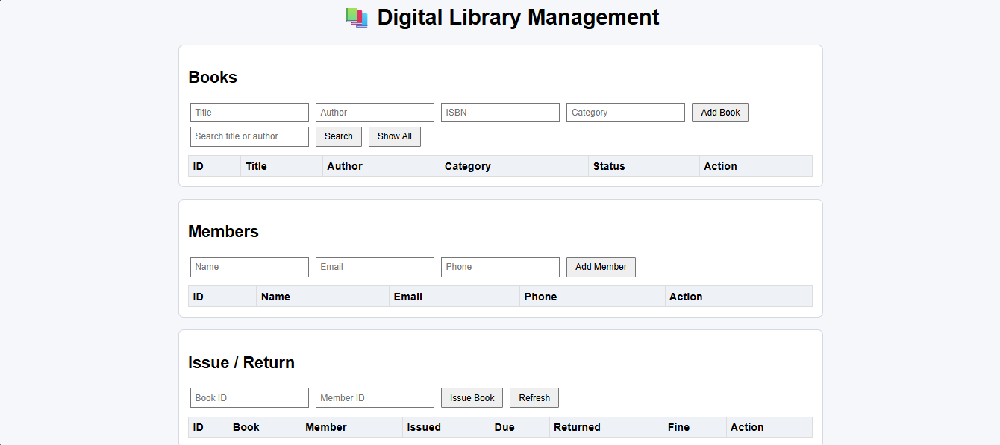
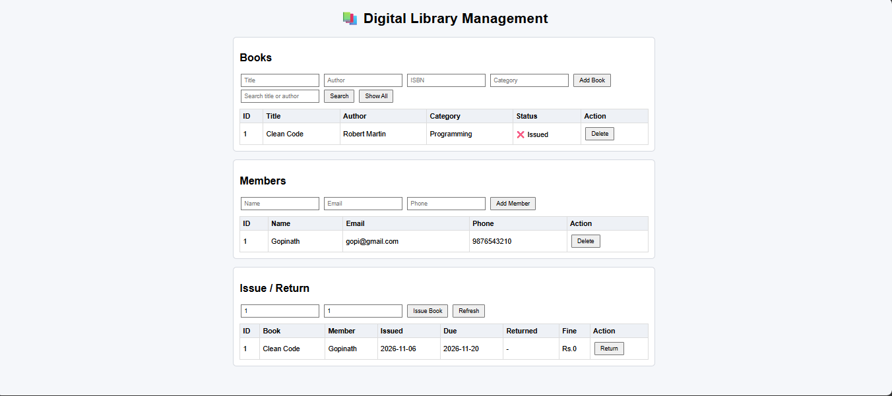
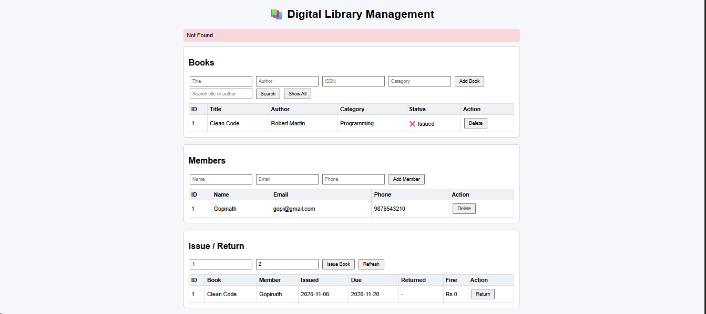
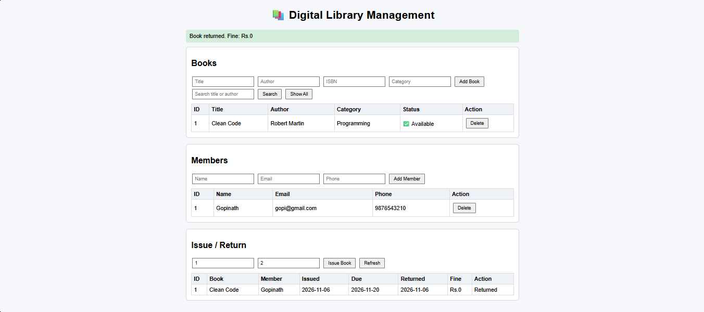
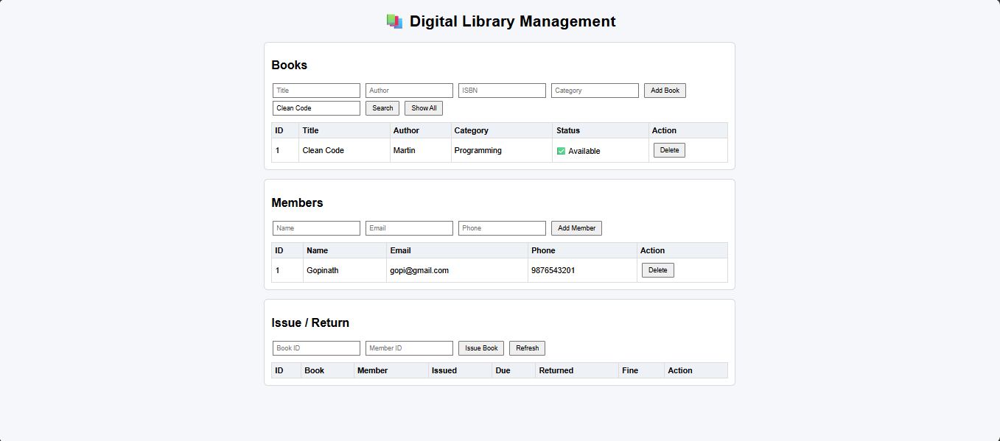

# Digital Library Management System
🌐 **Live Demo:** https://library-management-35pb.onrender.com/

Spring Boot REST API + simple HTML UI for managing books, members, and issue/return with fines.

## Tech stack
Java 17, Spring Boot 4.1.2, Spring Data JPA, H2 (default) / MySQL, HTML + JavaScript (fetch API)

## Features
- Add / update / delete / search books
- Register / update / delete members (unique email)
- Issue a book (14 days), max 3 books per member, no double-issue
- Return a book, fine Rs.5 per late day
- Cannot delete books/members that have issue history

## Run
1. `./mvnw spring-boot:run` (or Run `LibraryManagementApplication` in IntelliJ)
2. Open http://localhost:8080/
3. H2 console: http://localhost:8080/h2-console (JDBC URL `jdbc:h2:mem:librarydb`, user `sa`)

### Use MySQL instead
Create DB `librarydb`, put your password in `application-mysql.properties`, then run with profile `mysql`.

## REST API
| Method | URL | Purpose |
|---|---|---|
| GET/POST | /api/books | list / add |
| GET/PUT/DELETE | /api/books/{id} | get / update / delete |
| GET | /api/books/search?keyword= | search |
| GET | /api/books/available | available books |
| GET/POST | /api/members | list / add |
| GET/PUT/DELETE | /api/members/{id} | get / update / delete |
| POST | /api/issues?bookId=&memberId= | issue |
| PUT | /api/issues/{id}/return | return |
| GET | /api/issues, /api/issues/active, /api/issues/member/{id} | records |

## Package structure
`com.gopinath.library_management` -> `controller`, `service`, `repository`, `entity`

## Quick start on Windows
Double-click `run.bat` (needs JDK 17), or in IntelliJ: File > Open > select `pom.xml` > Open as Project.

## Screenshots
## Screenshots

### Home

### Book Issued

### Error Message

### Return with Fine

### Search

